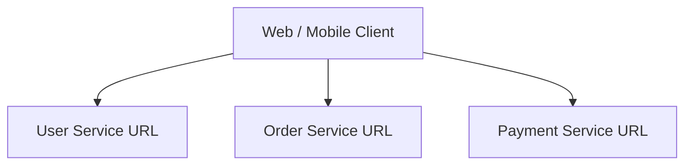
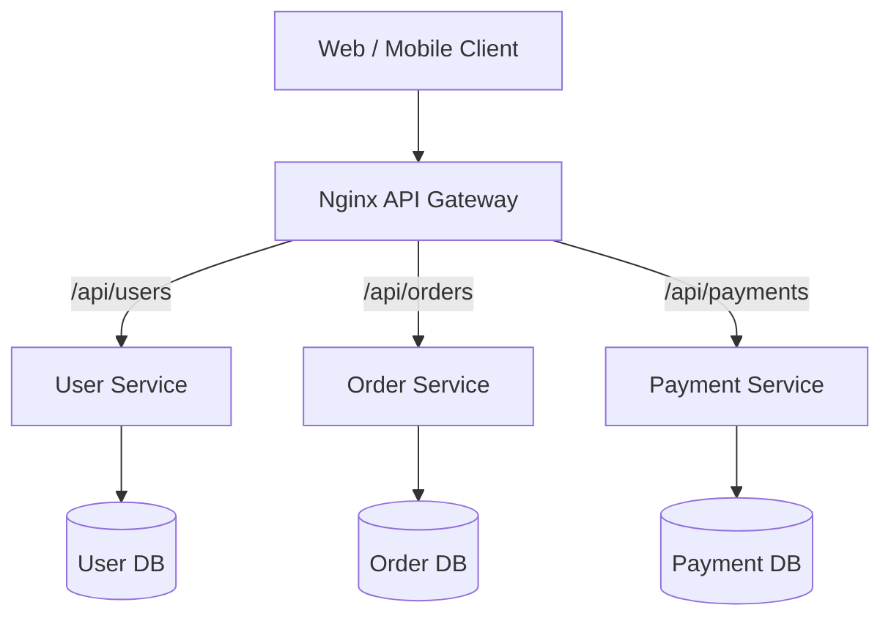
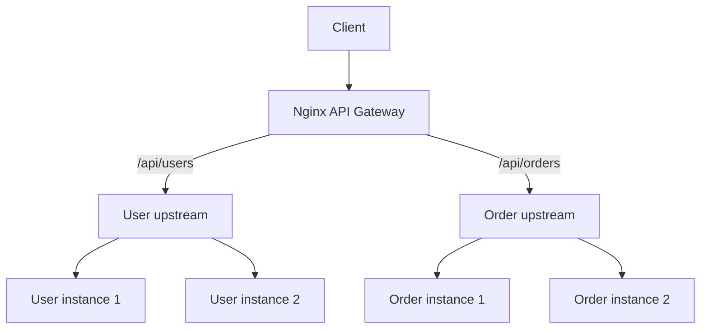

# API Gateway with Nginx + Node.js/Express
## Theory, hands-on POC, testing, and interview preparation

**Environment:** Ubuntu, Nginx installed directly on the host, Node.js/Express processes on separate ports. No Docker or Docker Compose required.


> The image is a visual overview. Use the detailed diagrams and configuration below as the source of truth for the practical implementation.

## 1. Learning objectives

By the end, you should be able to:
- Explain API Gateway, reverse proxy, and load balancer differences.
- Route different URL paths to different Express services using Nginx.
- Load balance multiple instances of one service.
- Configure proxy headers, timeouts, request-size limits, and rate limiting.
- Test routing and backend failure using `curl`.
- Explain gateway architecture and trade-offs in a Senior Node.js / Tech Lead interview.

## 2. What is an API Gateway?

An **API Gateway** is a single entry point between clients and backend services. It receives client requests, applies cross-cutting policies, and routes requests to the appropriate service.

Typical responsibilities:
1. **Routing:** `/api/users` goes to User Service; `/api/orders` goes to Order Service.
2. **Authentication and authorization:** validate identity and access.
3. **Rate limiting:** restrict excessive requests.
4. **TLS termination:** handle HTTPS certificates at the edge.
5. **Request/response transformation:** adapt headers, paths, or payloads.
6. **Load balancing:** distribute traffic across service instances.
7. **Observability:** logs, metrics, correlation IDs, and tracing.
8. **Resilience:** timeouts, connection limits, and carefully designed retries.

Nginx is a web server and reverse proxy that can implement many gateway-style capabilities through configuration and additional modules or services. A basic Nginx configuration is not automatically a complete API management platform.

## 3. Architecture

### Without an API Gateway



Clients must know multiple service addresses, and cross-cutting policies may be duplicated.

### With an API Gateway



Clients call one public endpoint. Nginx routes each request to the correct internal service.

### Gateway plus load balancing



**Remember:** Path-based routing selects a service; load balancing selects an instance within that service.

## 4. API Gateway vs reverse proxy vs load balancer

| Concept | Main responsibility | Example |
|---|---|---|
| Reverse proxy | Accept inbound requests and forward them to backend servers | Nginx `proxy_pass` |
| Load balancer | Distribute traffic across multiple backend instances | Nginx `upstream` |
| API Gateway | Centralize API routing and policies across services | Nginx plus auth, rate-limit, and observability integrations |

These are overlapping roles. Nginx can act as a reverse proxy, load balancer, and lightweight API gateway.

**Interview answer:** A reverse proxy describes the intermediary role. A load balancer describes distribution across targets. An API Gateway is an API-focused entry point that can combine routing, traffic management, security, and observability policies.

## 5. What Nginx can and cannot do

Nginx can provide:
- Host-based and path-based routing.
- Upstream pools and load balancing.
- TLS termination.
- Request-size limits and timeouts.
- Basic request rate limiting using `limit_req`.
- IP allow/deny rules.
- Access and error logging.
- Forwarded headers.

A basic Nginx configuration does **not** automatically provide JWT validation, OAuth flows, API keys, developer portals, API subscriptions, or full API lifecycle management. These require suitable modules, an external authentication/authorization service, or a dedicated API management product.

---

# 6. Hands-on POC on Ubuntu — no Docker

We will create:
- Nginx listening on port `8080`.
- User Service on port `3001`.
- Order Service on port `3002`.
- A second User Service instance on port `3003`.

## 6.1 Prerequisites

```bash
node -v
npm -v
nginx -v
```

If Nginx is not installed:

```bash
sudo apt update
sudo apt install nginx -y
sudo systemctl enable --now nginx
```

Use a supported Node.js LTS release; Node.js 20+ is recommended.

## 6.2 Create the project

```bash
mkdir -p ~/api-gateway-poc
cd ~/api-gateway-poc
npm init -y
npm install express
```

Project structure:

```text
api-gateway-poc/
├── package.json
├── user-service.js
└── order-service.js
```

## 6.3 Create `user-service.js`

```javascript
const express = require("express");
const os = require("node:os");

const app = express();
app.use(express.json());

const PORT = Number(process.env.PORT || 3001);
const INSTANCE = process.env.INSTANCE || "users-1";

app.get("/health", (req, res) => {
  res.json({ status: "ok", service: "users", instance: INSTANCE });
});

app.get("/users", (req, res) => {
  res.json({
    service: "User Service",
    instance: INSTANCE,
    users: [
      { id: 1, name: "Asha" },
      { id: 2, name: "Rahul" }
    ],
    hostname: os.hostname(),
    receivedPath: req.originalUrl
  });
});

app.listen(PORT, "127.0.0.1", () => {
  console.log(`User Service ${INSTANCE} listening on ${PORT}`);
});
```

## 6.4 Create `order-service.js`

```javascript
const express = require("express");

const app = express();
app.use(express.json());

const PORT = Number(process.env.PORT || 3002);

app.get("/health", (req, res) => {
  res.json({ status: "ok", service: "orders" });
});

app.get("/orders", (req, res) => {
  res.json({
    service: "Order Service",
    orders: [
      { id: 101, item: "Laptop", status: "SHIPPED" },
      { id: 102, item: "Keyboard", status: "PROCESSING" }
    ],
    receivedPath: req.originalUrl
  });
});

app.listen(PORT, "127.0.0.1", () => {
  console.log(`Order Service listening on ${PORT}`);
});
```

## 6.5 Start the backend processes

Open three separate terminals.

Terminal 1:

```bash
cd ~/api-gateway-poc
PORT=3001 INSTANCE=users-1 node user-service.js
```

Terminal 2:

```bash
cd ~/api-gateway-poc
PORT=3003 INSTANCE=users-2 node user-service.js
```

Terminal 3:

```bash
cd ~/api-gateway-poc
PORT=3002 node order-service.js
```

Test each service directly:

```bash
curl http://127.0.0.1:3001/users
curl http://127.0.0.1:3003/users
curl http://127.0.0.1:3002/orders
```

Always test backends directly first. This separates application problems from gateway configuration problems.

---

# 7. Configure Nginx as the API Gateway

Create a site configuration:

```bash
sudo nano /etc/nginx/sites-available/api-gateway
```

Add:

```nginx
# Two instances belonging to the User Service.
upstream user_service {
    server 127.0.0.1:3001;
    server 127.0.0.1:3003;
}

# One Order Service instance.
upstream order_service {
    server 127.0.0.1:3002;
}

server {
    listen 8080;
    server_name localhost;

    location /api/users/ {
        # /api/users/users becomes /users
        rewrite ^/api/users/(.*)$ /$1 break;

        proxy_pass http://user_service;
        proxy_http_version 1.1;

        proxy_set_header Host $host;
        proxy_set_header X-Real-IP $remote_addr;
        proxy_set_header X-Forwarded-For $proxy_add_x_forwarded_for;
        proxy_set_header X-Forwarded-Proto $scheme;

        proxy_connect_timeout 3s;
        proxy_read_timeout 30s;
    }

    location /api/orders/ {
        # /api/orders/orders becomes /orders
        rewrite ^/api/orders/(.*)$ /$1 break;

        proxy_pass http://order_service;
        proxy_http_version 1.1;

        proxy_set_header Host $host;
        proxy_set_header X-Real-IP $remote_addr;
        proxy_set_header X-Forwarded-For $proxy_add_x_forwarded_for;
        proxy_set_header X-Forwarded-Proto $scheme;

        proxy_connect_timeout 3s;
        proxy_read_timeout 30s;
    }
}
```

### Configuration explained

| Directive | Meaning |
|---|---|
| `upstream` | Defines a backend service pool |
| `server` inside upstream | Adds one backend instance |
| `location` | Matches a URL path |
| `rewrite` | Changes the URI before proxying |
| `proxy_pass` | Forwards the request |
| `proxy_set_header` | Passes request metadata |
| `proxy_connect_timeout` | Limits time to establish upstream connection |
| `proxy_read_timeout` | Limits the wait between successive upstream reads |

The rewrite removes the public URL prefix. `break` stops further rewrite processing in the current location. Since `proxy_pass` references an upstream without a URI suffix, the rewritten URI is forwarded.

## 7.1 Enable the configuration

```bash
sudo ln -s \
  /etc/nginx/sites-available/api-gateway \
  /etc/nginx/sites-enabled/api-gateway
```

If the symlink already exists, do not create it again.

Validate and reload:

```bash
sudo nginx -t
sudo systemctl reload nginx
```

If port `8080` is already in use:

```bash
sudo ss -lntp | grep :8080
```

---

# 8. Test the API Gateway

User Service:

```bash
curl -i http://localhost:8080/api/users/users
```

Repeat to observe load balancing:

```bash
for i in {1..10}; do
  curl -s http://localhost:8080/api/users/users
  echo
done
```

You should see `users-1` and `users-2` handling requests. Do not assume every test produces a perfectly equal count; connection reuse and request scheduling can affect observations.

Order Service:

```bash
curl -i http://localhost:8080/api/orders/orders
```

Health endpoints:

```bash
curl http://localhost:8080/api/users/health
curl http://localhost:8080/api/orders/health
```

The public health URLs are routed through the same gateway and rewritten to `/health`.

---

# 9. Add basic rate limiting

Inside the Nginx `http` context (commonly in `/etc/nginx/nginx.conf`, outside the `server` block), add:

```nginx
limit_req_zone $binary_remote_addr zone=api_limit:10m rate=5r/s;
```

Inside a relevant `location` block:

```nginx
limit_req zone=api_limit burst=10 nodelay;
```

This configures an average rate of five requests per second per client key, with a burst allowance.

Test:

```bash
for i in {1..30}; do
  curl -s -o /dev/null -w "%{http_code}\n" \
    http://localhost:8080/api/users/users
done
```

Nginx normally returns `503` for rejected requests unless `limit_req_status` is changed.

Behind another proxy, configure trusted real-IP handling carefully. Otherwise, Nginx may rate-limit all users under the proxy's IP rather than each client.

---

# 10. Add a request-size limit

Inside the `server` block:

```nginx
client_max_body_size 2m;
```

This limits the maximum client request body to 2 MB. Express body parsers can have their own limits too; configure both layers intentionally.

---

# 11. Authentication and authorization

A gateway can enforce authentication before a request reaches a backend. Common approaches:
- Validate an access token through a supported gateway integration.
- Use an external authorization service.
- Forward verified identity information over a trusted internal network.
- Keep business-specific authorization checks inside the services.

For JWT validation, verify the signature, allowed algorithm, issuer, audience, expiry, and key rotation. Do not merely decode a JWT and trust it.

**This POC does not validate JWTs.** Do not claim that it is an authenticated gateway. Add an appropriate authentication integration or authorization service before using it for protected APIs.

---

# 12. Failure and resilience tests

Stop the User Service process on port `3001` with `Ctrl+C`.

```bash
for i in {1..10}; do
  curl -i http://localhost:8080/api/users/users
done
```

Nginx can mark a failed peer unavailable based on passive failure observations and continue with another eligible peer. Exact behavior depends on the failure type and upstream configuration.

Restart the service:

```bash
PORT=3001 INSTANCE=users-1 node user-service.js
```

Stop the Order Service on port `3002` and test:

```bash
curl -i http://localhost:8080/api/orders/orders
```

Inspect logs:

```bash
sudo tail -f /var/log/nginx/error.log
sudo tail -f /var/log/nginx/access.log
```

Useful diagnostics:

```bash
sudo nginx -t
sudo nginx -T
sudo systemctl status nginx
sudo ss -lntp
```

---

# 13. Production design considerations

## Stateless services and shared sessions

A service should not rely on one process's local memory for state needed by later requests. If sessions are stored in memory, a request routed to another instance may not find the session.

Use Redis or another shared session store. Keep signing secrets and cookie configuration consistent across instances.

## Gateway vs service discovery

This POC uses static upstream addresses. In dynamic environments, service discovery or orchestration updates backend targets as instances change.

## Gateway vs service mesh

- API Gateway commonly handles **north-south** traffic: clients entering the system.
- Service mesh commonly handles **east-west** traffic: communication among internal services.

They can coexist.

## Avoid making the gateway a bottleneck

- Run redundant gateway instances behind a highly available entry point.
- Keep gateway logic focused on cross-cutting concerns.
- Avoid putting business logic and database dependencies in the gateway.
- Monitor CPU, memory, connections, latency, and errors.
- Use sensible timeouts and request limits.
- Scale backend services independently.

---

# 14. Interview questions and answers — Nginx + Node/Express focus

## Fundamentals

### 1. What is an API Gateway?
A single entry point for client requests. It routes requests to backend services and can apply policies such as authentication, rate limiting, TLS termination, and logging.

### 2. Why use an API Gateway in microservices?
It hides internal service topology from clients and centralizes common entry-point concerns, reducing duplicated client logic.

### 3. Is Nginx an API Gateway?
Nginx can perform gateway-style functions such as path routing, reverse proxying, load balancing, TLS termination, and rate limiting. It is not automatically a full API management platform.

### 4. Difference between API Gateway and load balancer?
A load balancer distributes requests across instances of a service. An API Gateway provides a broader API entry point and can route between services while applying policies.

### 5. What is north-south vs east-west traffic?
North-south traffic enters or leaves the system, typically between clients and services. East-west traffic is communication between internal services.

## Nginx

### 6. What is an Nginx upstream?
A named group of backend servers that Nginx can proxy requests to and balance across.

### 7. What does `proxy_pass` do?
It forwards a request from Nginx to a configured upstream or backend URL.

### 8. What is the difference between `Host` and `X-Forwarded-For`?
`Host` carries the host header. `X-Forwarded-For` carries the client IP chain through proxies. Applications should trust forwarded headers only from known proxies.

### 9. What is `X-Real-IP`?
A commonly used header to pass the client IP to the backend. The proxy should overwrite it; otherwise, a client may spoof it.

### 10. `proxy_connect_timeout` vs `proxy_read_timeout`?
The first limits time to establish the upstream connection. The second limits the wait between successive reads from the upstream; it is not necessarily a total request deadline.

### 11. What is `limit_req_zone`?
It defines a shared-memory zone and key for request rate limiting. It belongs in the `http` context and is applied using `limit_req`.

### 12. Difference between 502 and 504?
502 generally indicates a failed or invalid upstream connection/response. 504 indicates the upstream did not respond within the configured timeout.

## Node.js and Express

### 13. Why run multiple Node.js instances?
A single Node.js process executes JavaScript on its event loop. Multiple processes can use multiple CPU cores and increase service capacity; Nginx can distribute requests among them.

### 14. Does Node.js support concurrency?
Yes. Node.js handles many concurrent I/O operations through its event loop and asynchronous APIs. CPU-intensive JavaScript can block the event loop.

### 15. Cluster vs independent Node processes?
The cluster module creates worker processes that can share a server port through a primary process. Independent processes can listen on separate ports and be balanced by Nginx. Both have operational trade-offs.

### 16. Why should Express services be stateless?
Any instance should be able to handle any request. This simplifies horizontal scaling, replacement, and deployment. Shared state belongs in Redis, databases, or object storage.

### 17. Why can in-memory sessions fail behind a load balancer?
A session created in one process may not exist in another. Use a shared store such as Redis.

### 18. How does Express know the original client IP behind Nginx?
Nginx forwards headers such as `X-Forwarded-For`. Express can use them when `trust proxy` is configured correctly. Trust only the actual proxy chain.

Example for a known one-proxy topology:

```javascript
app.set("trust proxy", 1);
```

Do not blindly trust forwarded headers from arbitrary clients.

### 19. What is graceful shutdown?
Stop accepting new work, let in-flight requests finish within a deadline, close dependency connections, and exit cleanly.

### 20. How do you handle CPU-intensive work in Node.js?
Avoid blocking the event loop. Use worker threads for suitable CPU-bound JavaScript or offload work to separate workers through a queue.

## Scenario-based

### 21. API works on port 3001 but returns 404 through Nginx. What do you check?
Check the `location` match, rewrite expression, `proxy_pass` URI behavior, backend route, and effective config with `nginx -T`.

### 22. Login fails randomly after scaling to two instances. Why?
Sessions may be stored in process memory. Move them to shared storage such as Redis and verify cookie/session configuration.

### 23. Nginx returns 502 after deployment. What do you investigate?
Backend process status, port, address, network access, application startup logs, and Nginx error logs.

### 24. Gateway is slow. What do you investigate?
Measure gateway latency separately from upstream latency. Check backend response time, DNS, connection establishment, dependency latency, resource usage, and timeouts.

### 25. Should authentication live only in the gateway?
No. The gateway can authenticate and enforce coarse-grained policies, but services should still enforce business authorization and resource ownership.

### 26. Should the gateway contain business logic?
Keep business logic in the relevant service. The gateway should primarily handle cross-cutting concerns to avoid tight coupling and bottlenecks.

### 27. What if the API Gateway goes down?
It can become a single point of failure. Deploy redundant gateway instances behind a highly available entry point and monitor them.

### 28. How do you prevent duplicate payment requests during retries?
Use idempotency keys, durable transaction state, and carefully designed retry behavior. Do not blindly retry non-idempotent operations.

### 29. Gateway timeout vs application timeout?
The gateway timeout is enforced by the proxy while waiting for the upstream. Application timeouts are enforced inside the service or its dependencies. Align deadlines across the request path.

### 30. How would you secure an API Gateway?
Use HTTPS, strong authentication and authorization, rate limits, request-size limits, trusted proxy configuration, secure headers, secrets management, access controls, logging, monitoring, and regular updates.

---

# 15. Practical assignments

Complete these in order:

1. Add a Product Service on port `3004`.
2. Route `/api/products/*` to Product Service.
3. Add a second Order Service instance and configure an upstream pool.
4. Add `/health` to every service.
5. Configure rate limiting and test rejected requests.
6. Configure a request body size limit.
7. Add a request ID and log it in Nginx and Express.
8. Add Redis-backed sessions and verify requests work across instances.
9. Add an authentication integration and verify invalid tokens are rejected.
10. Add graceful shutdown and test an in-flight request during shutdown.
11. Run a load test and measure p50, p95, p99 latency and error rate.
12. Draw a production API Gateway architecture and explain every component.

For each exercise, record:

**Hypothesis → Change → Test → Observation → Conclusion**

---

# 16. Two-minute interview explanation

"In our microservices architecture, clients communicate through a single API Gateway rather than calling each internal service directly. We use Nginx as a reverse proxy and gateway layer. Based on URL paths, Nginx routes requests to services such as User, Order, and Payment. Each service can have multiple instances configured in an upstream group, where Nginx distributes traffic using a policy such as round robin or least connections.

At the gateway layer, we configure TLS termination, forwarded headers, request limits, rate limiting, timeouts, and access logging. Authentication can be integrated with an identity provider or authorization service. The Express services remain responsible for business logic and resource-level authorization.

For scalability, services should be stateless. Shared sessions can be stored in Redis, durable data in databases, and files in object storage. We monitor gateway and service latency, errors, and resource utilization. We also use graceful shutdown and safe retry/idempotency strategies to reduce deployment and failure impact."

---

# 17. Official documentation

- Nginx proxy module: https://nginx.org/en/docs/http/ngx_http_proxy_module.html
- Nginx upstream module: https://nginx.org/en/docs/http/ngx_http_upstream_module.html
- Nginx request limiting: https://nginx.org/en/docs/http/ngx_http_limit_req_module.html
- Nginx access module: https://nginx.org/en/docs/http/ngx_http_access_module.html
- Express behind proxies: https://expressjs.com/en/guide/behind-proxies.html
- Express production best practices: https://expressjs.com/en/advanced/best-practice-performance.html
- Node.js cluster: https://nodejs.org/api/cluster.html
- Node.js HTTP: https://nodejs.org/api/http.html

## Final revision checklist

- [ ] API Gateway vs reverse proxy vs load balancer.
- [ ] Path-based routing in Nginx.
- [ ] Nginx upstream groups and balancing policies.
- [ ] `proxy_pass`, `proxy_set_header`, and timeout directives.
- [ ] Authentication vs authorization.
- [ ] Rate limiting and request-size limits.
- [ ] Express `trust proxy` and client IP handling.
- [ ] Stateless APIs and Redis-backed sessions.
- [ ] Graceful shutdown and safe retries.
- [ ] 502 vs 504 troubleshooting.
- [ ] Gateway high availability and observability.

**Best learning approach:** Build the POC first, change one Nginx directive at a time, test with `curl`, and explain the observed behavior aloud.
