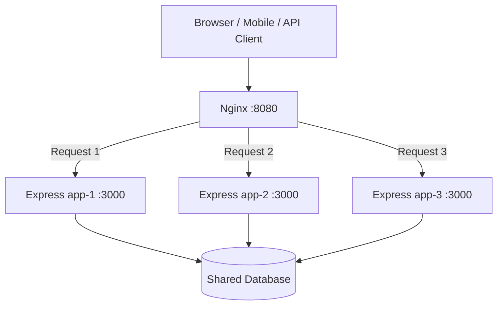
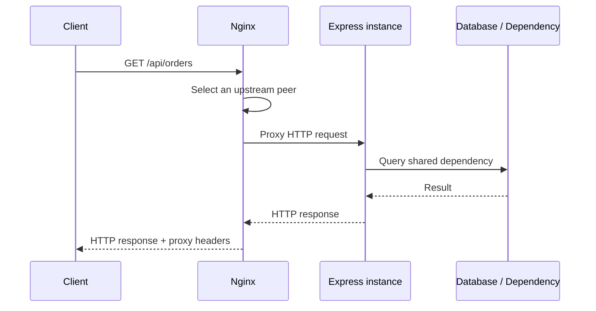
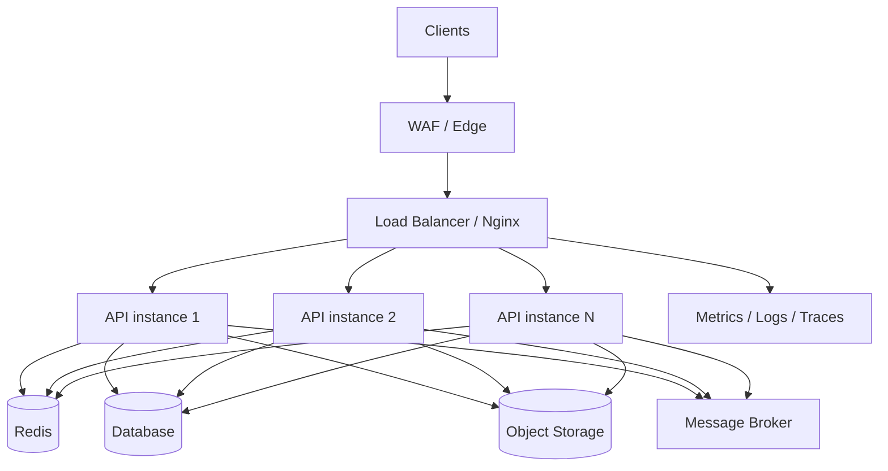

x`# Mastering Load Balancing with Nginx + Node.js/Express
## Theory, hands-on POC, testing strategy, and interview preparation

**Audience:** Backend / Full-stack engineers who know Node.js and Express and want to understand how production traffic is distributed across multiple application instances.

**Outcome:** You will build a working system with three Express servers behind Nginx, observe request distribution, compare algorithms, simulate failures, run load tests, and explain the architecture confidently in interviews.

---

# 1. Learning roadmap

| Stage | Learn | Practical outcome |
|---|---|---|
| 1 | HTTP, ports, processes, reverse proxy | Understand the request path |
| 2 | Vertical vs horizontal scaling | Explain why multiple instances help |
| 3 | Load-balancing algorithms | Compare round robin, least connections, IP hash |
| 4 | Nginx configuration | Configure an upstream pool and proxy headers |
| 5 | Express application design | Run the same app as multiple instances |
| 6 | Docker Compose | Run three app containers and Nginx |
| 7 | Failure and resilience | Stop an instance and inspect behavior |
| 8 | Performance testing | Measure throughput, latency, and distribution |
| 9 | Production concerns | Sessions, shared state, TLS, observability |
| 10 | Interview preparation | Answer architecture and troubleshooting questions |

Suggested pace: 5–7 focused days. Spend more time running experiments than memorizing definitions.

---

# 2. What is load balancing?

A **load balancer** sits in front of multiple application instances and distributes incoming requests among them.

Without a load balancer, clients may call one application process directly. That process can become a bottleneck or a single point of failure.

With a load balancer, clients use one stable endpoint. The load balancer selects an available backend from a pool.

## Architecture overview



In this POC, the database is intentionally omitted. The important idea is that all three app containers run the same code but have different instance IDs.

## Why do we need it?

1. **Scalability:** add more instances when demand grows.
2. **Availability:** avoid depending on one application process.
3. **Traffic distribution:** spread work across multiple servers.
4. **Maintenance:** drain or replace instances with less disruption.
5. **Performance:** increase total capacity when the workload can scale horizontally.

A load balancer does not automatically make an application faster. It helps distribute work; database bottlenecks, locks, network limits, and inefficient code can still dominate.

---

# 3. Core concepts you must understand

## 3.1 Vertical vs horizontal scaling

| Type | Meaning | Example | Limitation |
|---|---|---|---|
| Vertical scaling | Increase resources on one machine | 2 CPU → 8 CPU, 4 GB → 32 GB RAM | Hardware ceiling; one machine remains a failure domain |
| Horizontal scaling | Add more machines/processes/containers | 1 Express instance → 3 instances | Requires coordination around shared state and deployment |

**Interview answer:** Vertical scaling increases the capacity of one machine. Horizontal scaling adds more instances and distributes work between them. Horizontal scaling is common for stateless web APIs because capacity can be increased incrementally.

## 3.2 What is a reverse proxy?

A reverse proxy accepts requests on behalf of backend servers and forwards them to an appropriate upstream.

Typical responsibilities:
- Route requests to backend services.
- Terminate TLS.
- Apply request/response policies.
- Add or forward headers.
- Hide internal backend topology.
- Distribute traffic when configured as a load balancer.

A forward proxy represents clients going outward. A reverse proxy represents servers receiving inbound traffic.

## 3.3 Reverse proxy vs load balancer

These terms overlap but are not identical:

- **Reverse proxy** describes the intermediary role between clients and servers.
- **Load balancer** describes distributing traffic across multiple targets.
- Nginx can perform both roles in the same configuration.

## 3.4 What is an upstream?

In Nginx, an `upstream` group names a pool of backend servers.

```nginx
upstream node_api {
    server app1:3000;
    server app2:3000;
    server app3:3000;
}
```

The `proxy_pass` directive forwards a request to that group:

```nginx
location / {
    proxy_pass http://node_api;
}
```

---

# 4. Load-balancing algorithms

## 4.1 Round robin

Nginx uses round robin by default when no other balancing directive is specified. Requests are distributed in rotation across eligible peers.

Example with three healthy instances:

```text
Request 1 → app-1
Request 2 → app-2
Request 3 → app-3
Request 4 → app-1
Request 5 → app-2
Request 6 → app-3
```

Good starting point when instances have similar capacity and request costs are reasonably similar.

## 4.2 Least connections

```nginx
upstream node_api {
    least_conn;
    server app1:3000;
    server app2:3000;
    server app3:3000;
}
```

Nginx selects the peer with the fewest active connections (with weighting/tie-breaking rules applied).

Useful when request durations vary significantly. It balances active connections, not CPU usage or actual business workload.

## 4.3 IP hash

```nginx
upstream node_api {
    ip_hash;
    server app1:3000;
    server app2:3000;
    server app3:3000;
}
```

A client IP is used to choose a peer, providing a basic form of session affinity.

Limitations:
- Many users may share one public IP behind NAT.
- A user's IP can change.
- Backend membership changes can change mappings.
- It does not replicate session data.

Prefer shared session storage (for example Redis) over relying on affinity for correctness.

## 4.4 Weighted round robin

```nginx
upstream node_api {
    server app1:3000 weight=5;
    server app2:3000 weight=3;
    server app3:3000 weight=1;
}
```

Higher weight means the peer receives a larger share of requests under the weighted balancing method. Use weights when backend capacities differ and you have measured evidence to justify them.

## 4.5 Comparison

| Algorithm | Decision basis | Useful when | Watch out for |
|---|---|---|---|
| Round robin | Rotation / configured weights | Similar backends and request costs | Does not measure CPU or request complexity |
| Least connections | Active connection count | Request durations vary | Connections are only a proxy for workload |
| IP hash | Client IP mapping | Basic affinity is required | NAT, changing IPs, uneven distribution |
| Weighted | Configured capacity weights | Backends have different capacities | Weights need measurement and maintenance |

---

# 5. What happens when a request arrives?



Step by step:

1. Client resolves the public host and opens a connection to Nginx.
2. Nginx receives the HTTP request.
3. Nginx matches a `server` and `location` block.
4. `proxy_pass` sends the request to the configured upstream.
5. Nginx selects a backend according to the balancing policy.
6. Express handles the request and calls required dependencies.
7. Express returns a response to Nginx.
8. Nginx returns the response to the client.

---

# 6. Build the practical POC

The accompanying ZIP contains a runnable project:

```text
nginx-node-load-balancer-poc/
├── Dockerfile
├── docker-compose.yml
├── package.json
├── src/
│   └── server.js
├── nginx/
│   └── nginx.conf
└── scripts/
    └── load-test.js
```

## 6.1 Prerequisites

- Docker Desktop or Docker Engine with Docker Compose.
- Terminal or PowerShell.
- Optional: Node.js 20+ to run the load-test script locally.

## 6.2 Start all services

From the extracted project folder:

```bash
docker compose up --build -d
docker compose ps
```

Nginx is exposed at:

```text
http://localhost:8080
```

The three Express containers listen internally on port `3000`. They do not each need a separate public port.

## 6.3 Test request distribution

Linux/macOS:

```bash
for i in $(seq 1 12); do
  curl -s http://localhost:8080/
  echo
done
```

PowerShell:

```powershell
1..12 | ForEach-Object {
  Invoke-RestMethod http://localhost:8080/
}
```

Look at `instanceId`. You should see app-1, app-2, and app-3 serving requests.

**Important:** do not assume every possible test run will show a perfect 1:1:1 ratio. Connection reuse, request scheduling, failures, and the test method can affect observed distribution.

## 6.4 Understand the Express code

The app returns its identity:

```js
app.get("/", (req, res) => {
  res.json({
    message: "Hello from the Node.js API",
    instanceId: INSTANCE_ID,
    hostname: os.hostname(),
    pid: process.pid,
    timestamp: new Date().toISOString()
  });
});
```

Each container runs the same source but receives a different `INSTANCE_ID` environment variable. This lets you see which backend handled a request.

## 6.5 Understand the Nginx config

```nginx
upstream node_api {
    server app1:3000;
    server app2:3000;
    server app3:3000;
}

server {
    listen 80;

    location / {
        proxy_pass http://node_api;
        proxy_set_header Host $host;
        proxy_set_header X-Real-IP $remote_addr;
        proxy_set_header X-Forwarded-For $proxy_add_x_forwarded_for;
        proxy_set_header X-Forwarded-Proto $scheme;
    }
}
```

Key directives:

| Directive | Meaning |
|---|---|
| `upstream` | Defines a backend server group |
| `server` inside upstream | Adds a backend peer |
| `listen` | Port Nginx accepts traffic on |
| `location` | Matches request paths |
| `proxy_pass` | Forwards the request |
| `proxy_set_header` | Passes client/request metadata upstream |

The complete POC config also includes timeouts and an `X-Served-By` response header for inspection.

---

# 7. Experiments: test everything

## Experiment A — Observe all instances

1. Start the stack.
2. Send at least 30 requests.
3. Record how many responses each instance handled.
4. Repeat with a different request count.
5. Explain why the counts may not be perfectly equal.

## Experiment B — Compare balancing policies

1. Start with default round robin.
2. Uncomment `least_conn;` in the upstream.
3. Validate and reload Nginx:

```bash
docker compose exec nginx nginx -t
docker compose exec nginx nginx -s reload
```

4. Call `/api/work?delay=500` with concurrent clients.
5. Compare observed distribution and response times.
6. Try `ip_hash;` and send repeated requests from the same client.

Remember: a simple test may not demonstrate a clear advantage for least connections. Design a workload with different request durations to investigate its behavior.

## Experiment C — Stop one backend

```bash
docker compose stop app2
```

Send requests again. Inspect response status, logs, and which instance responds.

Then restore it:

```bash
docker compose start app2
```

**Nginx OSS caveat:** passive failure handling uses observed connection/response failures and configured parameters such as `max_fails` and `fail_timeout` (subject to peer/group behavior). It is not the same as Nginx Plus active health checks. A basic upstream configuration does not continuously probe every backend with a dedicated health-check request.

## Experiment D — Test a failing endpoint

```bash
curl -i http://localhost:8080/api/error
```

This endpoint deliberately returns HTTP 500. Observe the status and application logs. Do not assume every HTTP 500 should automatically be retried: retries can duplicate non-idempotent operations and need careful policy.

## Experiment E — Run the included load script

Install dependencies on your host:

```bash
npm install
npm run load -- 300 20
```

The first number is total requests; the second is concurrency.

The output reports:
- Requests completed and failures.
- Total elapsed time.
- Approximate requests per second.
- Per-instance request counts.

For more realistic performance testing, use k6, autocannon, or JMeter. Measure p50, p95, and p99 latency, not just average response time.

## Experiment F — Inspect logs and effective configuration

```bash
docker compose logs -f nginx
docker compose logs -f app1 app2 app3
docker compose exec nginx nginx -T
docker compose exec nginx nginx -t
```

## Stop the project

```bash
docker compose down
```

---

# 8. Node.js and Express concerns behind a load balancer

## 8.1 Stateless application design

A stateless API does not depend on one particular process's local memory to serve the next request.

Avoid relying on process-local state for:
- Login sessions.
- Shopping carts.
- OTP state.
- Job status.
- Rate-limit counters that must be global.
- Uploaded files that other instances must access.

Use shared infrastructure where appropriate:
- Redis for sessions, cache, and distributed coordination.
- A shared database for durable business data.
- Object storage for uploaded files.
- A message broker for asynchronous jobs.

## 8.2 Why in-memory sessions break

Imagine a user logs in and the load balancer sends the next request to a different Express process. If the session exists only in the first process's memory, the second process cannot find it.

Better approach:
- Store sessions in Redis or another shared store.
- Use secure, HTTP-only cookies.
- Configure cookie security and same-site behavior correctly.
- Keep authentication/session secrets consistent across instances.

## 8.3 File uploads

Do not save important uploads only inside one container's local filesystem. Another instance may receive the next request and not see the file.

Use shared object storage or a shared durable file service.

## 8.4 Graceful shutdown

When deploying or stopping an instance:
1. Stop accepting new work.
2. Allow in-flight requests to complete within a deadline.
3. Close database and message-broker connections.
4. Exit cleanly.

A load balancer cannot make an application graceful if the application terminates active work abruptly.

## 8.5 `trust proxy` in Express

When Express runs behind Nginx, configure proxy trust deliberately if you use `req.ip`, secure cookies, or protocol detection.

Example for a known one-proxy topology:

```js
app.set("trust proxy", 1);
```

Do not blindly trust arbitrary forwarded headers. The correct value depends on the actual proxy chain and which networks are trusted.

---

# 9. Production architecture: what changes?



Production checklist:

- [ ] TLS/HTTPS and certificate renewal.
- [ ] Explicit connection and read timeouts.
- [ ] Correct forwarded-header and trusted-proxy configuration.
- [ ] Readiness and liveness checks.
- [ ] Graceful shutdown and deployment draining.
- [ ] Shared sessions and shared durable state.
- [ ] Rate limiting and request-size limits.
- [ ] Structured logs with correlation/request IDs.
- [ ] Metrics: request rate, error rate, latency, active connections.
- [ ] Distributed tracing across API and dependencies.
- [ ] Capacity planning and autoscaling policy.
- [ ] Retry policy that avoids unsafe duplicate writes.
- [ ] Secrets management and least-privilege access.

---

# 10. Troubleshooting guide

| Symptom | Possible cause | What to inspect |
|---|---|---|
| Nginx returns 502 | Backend down, wrong service name/port, connection refused | Nginx error log, Compose service status |
| Nginx returns 504 | Backend did not respond before timeout | App latency, dependency latency, proxy timeouts |
| Only one instance appears | Test method, config not reloaded, wrong upstream | `nginx -T`, instance IDs, request pattern |
| Login randomly fails | Session stored in local process memory | Session store and cookie configuration |
| IP hash seems uneven | NAT/shared client IPs | Client network and peer mapping |
| High latency with healthy APIs | Database or downstream bottleneck | Distributed traces and dependency metrics |
| Requests fail during deployment | No draining/graceful shutdown | Deployment sequence and in-flight requests |

Useful commands:

```bash
docker compose ps
docker compose logs --tail=100 nginx
docker compose logs --tail=100 app1
docker compose exec nginx nginx -t
docker compose exec nginx nginx -T
```

---

# 11. Interview questions and answers

## Fundamentals

**1. What is load balancing?**  
It is the process of distributing incoming requests across multiple backend instances to improve scalability, availability, and resource utilization.

**2. What is Nginx?**  
Nginx is a web server that can also act as a reverse proxy, load balancer, TLS terminator, and cache.

**3. What is the difference between a reverse proxy and a load balancer?**  
A reverse proxy forwards inbound requests to backend servers. A load balancer distributes requests across multiple targets. One Nginx deployment can perform both roles.

**4. Why use Nginx in front of Node.js?**  
It provides a stable entry point, reverse proxying, traffic distribution, TLS termination, and useful request/connection controls. It can also serve static content efficiently.

**5. What is an upstream in Nginx?**  
A named group of backend servers that Nginx can proxy requests to.

## Algorithms

**6. What is round robin?**  
Requests are distributed in rotation among eligible upstream peers. It is the default Nginx upstream balancing method.

**7. When would you use least connections?**  
When request durations vary and active connections are a useful indicator of load. It does not directly measure CPU or application work.

**8. What is IP hash?**  
A client-IP-based peer selection method that can provide basic affinity. It is not a reliable substitute for shared session storage.

**9. What is weighted load balancing?**  
It assigns different weights to peers so higher-capacity peers receive a larger share of traffic.

## Reliability and scaling

**10. What happens if one Node.js instance goes down?**  
Nginx may mark a peer unavailable after passive failure observations and route requests to other eligible peers. Exact behavior depends on configuration. Active health checks are an Nginx Plus feature, not a standard Nginx OSS upstream feature.

**11. Does load balancing eliminate single points of failure?**  
No. The load balancer itself can become a single point of failure. Production systems use redundant load balancers or managed highly available load-balancing services.

**12. How do you maintain sessions across instances?**  
Use a shared session store such as Redis, with consistent signing/encryption configuration and secure cookies.

**13. Why should Node.js APIs be stateless?**  
Any instance should be able to handle any request. This makes horizontal scaling, replacement, and deployment easier.

**14. What is sticky session?**  
It is a mechanism that routes a client back to the same backend. It can help legacy stateful apps but creates affinity and scaling limitations.

**15. What is the difference between liveness and readiness?**  
Liveness asks whether a process should be restarted. Readiness asks whether it should receive traffic. A process may be alive but not ready because a dependency or initialization step is incomplete.

## Performance and debugging

**16. What is the difference between 502 and 504?**  
502 generally indicates an invalid or failed upstream response/connection. 504 indicates the proxy did not receive a timely upstream response.

**17. How do you measure load-balancer performance?**  
Measure throughput, p50/p95/p99 latency, error rate, active connections, backend distribution, and resource utilization under a controlled workload.

**18. Does round robin guarantee equal CPU usage?**  
No. It distributes requests, not CPU cycles. Different requests can have very different costs.

**19. Should Nginx retry every failed request?**  
No. Retrying a non-idempotent operation can duplicate side effects. Retry only when the failure mode, method, upstream behavior, and idempotency strategy make it safe.

**20. How do you debug 502 errors?**  
Check whether the upstream is running, service DNS and port, network connectivity, Nginx error logs, application logs, and whether the backend is closing connections unexpectedly.

## Scenario questions

**21. Users are randomly logged out after adding a second Express instance. What is likely wrong?**  
Sessions may be stored in local memory. Move them to a shared store such as Redis and verify cookie and session configuration.

**22. One backend receives much more traffic. What would you investigate?**  
Check the active balancing policy, peer weights, client IP distribution if using IP hash, connection reuse, peer health, and the measurement method. Compare per-instance request rate and latency.

**23. The API is still slow after adding three instances. Why?**  
The bottleneck may be the database, an external API, shared locks, CPU-heavy work, or network saturation. Use metrics and traces to identify the bottleneck before adding more instances.

**24. How would you deploy without dropping requests?**  
Mark the instance unready or drain it from the load balancer, stop new traffic, let in-flight requests finish, deploy/replace it, verify readiness, then return it to service. Repeat gradually.

**25. How would you scale background jobs?**  
Separate web request handling from job processing. Publish jobs to a queue and scale independent workers, making jobs idempotent and observable.

---

# 12. Practical assignments

Complete these without looking at the solution first:

1. Change the POC from three instances to five.
2. Add `/api/instance` and return hostname, PID, and instance ID.
3. Compare round robin and least connections using mixed request durations.
4. Try IP hash and explain why repeated calls from one machine may stick to one peer.
5. Stop one container and capture what happens before and after Nginx observes failure.
6. Add a Redis-backed session store and verify login works across instances.
7. Add a correlation ID and log it in both Nginx and Express.
8. Add a readiness endpoint that checks a dependency.
9. Add a graceful shutdown handler to Express.
10. Run a k6/autocannon test and report p50/p95/p99, throughput, and errors.

For each assignment, write down: **hypothesis → experiment → observation → conclusion**. This is an excellent interview preparation habit.

---

# 13. Suggested study sequence

**Day 1:** HTTP, reverse proxy, ports, vertical/horizontal scaling. Draw the request path.

**Day 2:** Nginx configuration, upstream groups, round robin, least connections, IP hash.

**Day 3:** Build and run the included Docker Compose POC. Explain every config line.

**Day 4:** Failure tests, timeouts, 502/504, health checks, graceful shutdown.

**Day 5:** Redis sessions, stateless API design, shared files, database connection pooling.

**Day 6:** Load testing, latency percentiles, logs, metrics, bottleneck analysis.

**Day 7:** Answer the interview questions aloud and present the POC architecture in 5 minutes.

---

# 14. Official references

- Nginx load balancing: https://nginx.org/en/docs/http/load_balancing.html
- Nginx reverse proxy: https://nginx.org/en/docs/http/ngx_http_proxy_module.html
- Nginx upstream module: https://nginx.org/en/docs/http/ngx_http_upstream_module.html
- Express behind proxies: https://expressjs.com/en/guide/behind-proxies.html
- Docker Compose: https://docs.docker.com/compose/
- k6 load testing: https://grafana.com/docs/k6/latest/

**Final interview tip:** Do not stop at “Nginx distributes traffic.” Be ready to explain how the upstream is selected, what happens when a peer fails, why sessions must be shared, how you measure latency, and how you deploy without interrupting in-flight requests.
