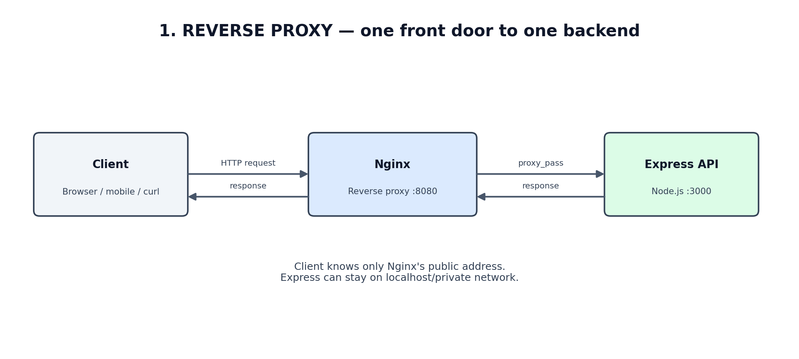
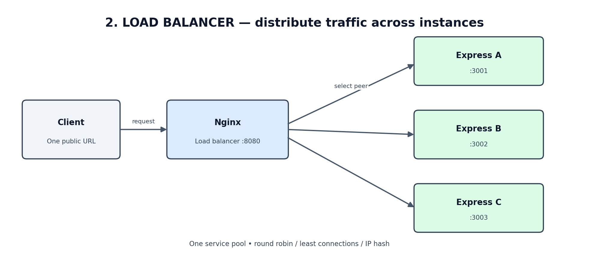
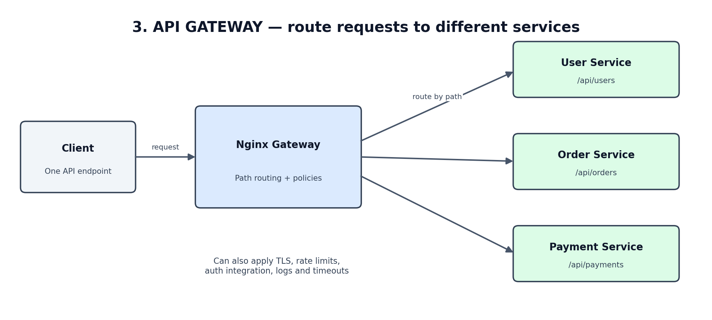
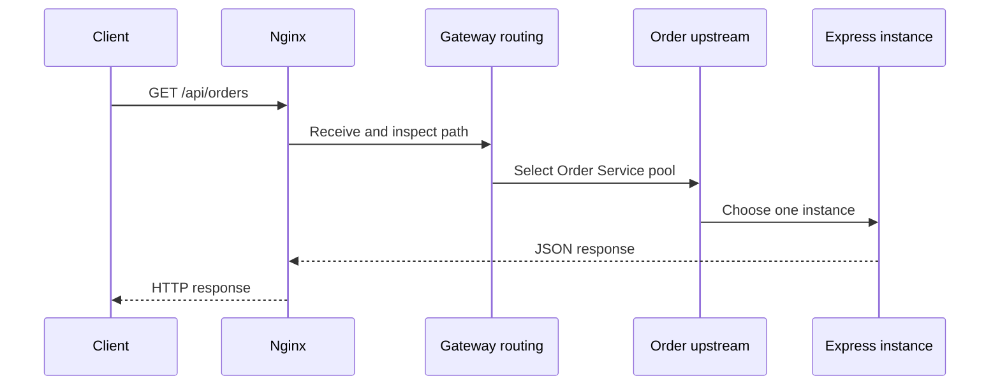

# Nginx + Node.js/Express: Three Concepts Made Easy
## Reverse Proxy • Load Balancer • API Gateway

**Ubuntu learning notes | No Docker required | Quick revision + practical examples**

> The three concepts are related, but they solve different problems. Learn them in this order: Reverse Proxy → Load Balancer → API Gateway.

---

# 1. Reverse Proxy



### Simple meaning

A **reverse proxy** is a server that stands between the client and your backend application. The client calls Nginx; Nginx forwards the request to Express and returns the response.

### Request flow

```text
Browser / curl
      |
      | http://localhost:8080
      v
   NGINX :8080
      |
      | proxy_pass
      v
 EXPRESS :3000
```

### Nginx example

```nginx
server {
    listen 8080;

    location / {
        proxy_pass http://127.0.0.1:3000;

        proxy_set_header Host $host;
        proxy_set_header X-Real-IP $remote_addr;
        proxy_set_header X-Forwarded-For $proxy_add_x_forwarded_for;
        proxy_set_header X-Forwarded-Proto $scheme;
    }
}
```

### Express example

```javascript
const express = require("express");
const app = express();

app.get("/", (req, res) => {
  res.json({ message: "Response from Express" });
});

app.listen(3000, "127.0.0.1", () => {
  console.log("Express running on 3000");
});
```

### Test on Ubuntu

```bash
# Directly call Express
curl http://127.0.0.1:3000/

# Call Express through Nginx
curl http://localhost:8080/
```

Both should return the Express response. The second request travels through Nginx first.

### Why use it?

- Hide backend ports and topology from clients.
- Provide one stable entry point.
- Handle HTTPS/TLS at the proxy.
- Apply request limits, headers, and logging.
- Forward requests to internal applications.

**Remember:** Reverse proxy = Nginx receives the request on behalf of the backend and forwards it.

---

# 2. Load Balancer



### Simple meaning

A **load balancer** distributes incoming requests across multiple instances of the same service.

Instead of one Express process, run three copies:

```text
                   NGINX :8080
                        |
                 User service pool
                 /       |       \
                v        v        v
           Express 1  Express 2  Express 3
             :3001      :3002      :3003
```

### Nginx upstream example

```nginx
upstream node_backend {
    # Round robin is the default when no policy is specified.
    server 127.0.0.1:3001;
    server 127.0.0.1:3002;
    server 127.0.0.1:3003;
}

server {
    listen 8080;

    location / {
        proxy_pass http://node_backend;
    }
}
```

### Algorithms to remember

| Algorithm | Easy explanation | Useful when |
|---|---|---|
| Round robin | Take turns: 1 → 2 → 3 → 1 | Servers have similar capacity |
| Least connections | Choose peer with fewest active connections | Request durations vary |
| IP hash | Use client IP to choose a peer | Basic client affinity is needed |
| Weighted | Give stronger servers a larger share | Backend capacity differs |

Examples:

```nginx
upstream node_backend {
    least_conn;
    server 127.0.0.1:3001;
    server 127.0.0.1:3002;
}
```

Or:

```nginx
upstream node_backend {
    ip_hash;
    server 127.0.0.1:3001;
    server 127.0.0.1:3002;
}
```

Use one balancing policy at a time. Round robin is the default.

### Test

```bash
for i in {1..10}; do
  curl -s http://localhost:8080/
  echo
done
```

Return an `instanceId` from each Express process so you can see which instance handled each request.

### Why use it?

- Scale horizontally by adding instances.
- Distribute traffic across multiple processes/servers.
- Improve capacity and reduce dependence on one application process.
- Support backend maintenance and failure handling.

**Remember:** Load balancer = choose which instance of a service receives the request.

**Important:** Load balancing does not automatically make the whole system highly available. The load balancer itself, database, network, and dependencies also need resilience.

---

# 3. API Gateway



### Simple meaning

An **API Gateway** is a common entry point for multiple backend services. It routes requests to the correct service and can apply shared API policies.

Example:

```text
                       Client
                         |
                         v
                   NGINX GATEWAY
                         |
          +--------------+--------------+
          |              |              |
          v              v              v
      User Service   Order Service  Payment Service
       /api/users    /api/orders    /api/payments
```

### Path-based Nginx routing example

```nginx
upstream user_service {
    server 127.0.0.1:3001;
    server 127.0.0.1:3003;
}

upstream order_service {
    server 127.0.0.1:3002;
}

server {
    listen 8080;

    location /api/users/ {
        proxy_pass http://user_service/;
    }

    location /api/orders/ {
        proxy_pass http://order_service/;
    }
}
```

With these location and `proxy_pass` forms, Nginx replaces the matching location prefix with `/` when forwarding.

For example:
- `/api/users/users` → User Service receives `/users`.
- `/api/orders/orders` → Order Service receives `/orders`.

### Gateway responsibilities

| Responsibility | Meaning |
|---|---|
| Routing | Send `/api/users` to User Service |
| Authentication integration | Check identity/token using a suitable integration |
| Authorization | Enforce gateway-level access policies |
| Rate limiting | Limit excessive request rates |
| TLS termination | Handle HTTPS at the edge |
| Load balancing | Distribute traffic within a service's upstream pool |
| Observability | Centralize access logs and request IDs |
| Timeouts | Limit how long gateway waits for upstream work |

**Important:** Nginx can implement many gateway-style features, but a basic Nginx config does not automatically validate JWTs, implement OAuth, provide API keys, developer portals, subscriptions, or full API management. Those require suitable modules, integrations, or separate services.

**Remember:** API Gateway = choose which service receives the request and apply shared API policies.

---

# 4. The easiest way to distinguish all three

| Concept | Main question it answers | Example |
|---|---|---|
| Reverse Proxy | Where should I forward this incoming request? | Nginx forwards to Express |
| Load Balancer | Which instance of this service should receive it? | Express instance 1, 2, or 3 |
| API Gateway | Which backend service should handle this API, and which common policies apply? | Users, Orders, or Payments |

### One real-world example

Imagine an e-commerce application:

1. A customer opens the app and requests `/api/orders`.
2. Nginx receives the request as a reverse proxy.
3. The API Gateway routing rule selects the Order Service.
4. The Order Service has three instances; the load-balancing policy selects one.
5. The selected Express instance processes the request and returns a response.



These roles can all be implemented in one Nginx deployment. They are conceptual responsibilities, not necessarily three separate servers.

---

# 5. Interview questions and short answers

### Q1. What is a reverse proxy?

A reverse proxy accepts client requests on behalf of backend servers and forwards them to the appropriate backend. Nginx is a common example.

### Q2. What is a load balancer?

A load balancer distributes requests across multiple backend instances to improve capacity and availability.

### Q3. What is an API Gateway?

An API Gateway is a common entry point for APIs. It routes requests to backend services and can apply policies such as authentication integration, rate limiting, TLS, and logging.

### Q4. Is Nginx a reverse proxy or a load balancer?

It can be both. `proxy_pass` provides reverse proxying; an `upstream` group with multiple servers provides load balancing.

### Q5. Is Nginx an API Gateway?

It can provide API Gateway-style routing and traffic policies. A basic Nginx deployment is not automatically a full API management platform.

### Q6. What is the difference between path routing and load balancing?

Path routing selects a service based on the URL. Load balancing selects an instance within that service's backend pool.

### Q7. What happens if one Express instance goes down?

Nginx can mark an upstream peer unavailable based on passive failure observations and route eligible requests to other peers. Exact behavior depends on configuration. Nginx Open Source passive checks are not the same as Nginx Plus active health checks.

### Q8. Why should Express APIs be stateless?

Any instance should be able to handle any request. Store shared sessions in Redis or another shared store rather than process memory.

### Q9. What are `X-Forwarded-For` and `X-Real-IP`?

They are commonly used headers for passing client IP information through a proxy. The application must trust them only from known proxies.

### Q10. What is the difference between 502 and 504?

502 generally means a failed connection or invalid upstream response. 504 means the upstream did not respond within the configured timeout.

### Q11. Does a reverse proxy automatically make an application secure?

No. You still need TLS, access controls, safe headers, trusted proxy configuration, backend network restrictions, authentication, and application-level authorization.

### Q12. Can one Nginx instance do all three jobs?

Yes. It can reverse-proxy requests, route paths to different services, and load balance across instances. Additional integrations may be needed for advanced API security and management.

---

# 6. Ubuntu commands for revision

```bash
# Validate Nginx configuration
sudo nginx -t

# Reload configuration without a full restart
sudo systemctl reload nginx

# Show the complete effective configuration
sudo nginx -T

# Nginx access log
sudo tail -f /var/log/nginx/access.log

# Nginx error log
sudo tail -f /var/log/nginx/error.log

# See listening ports
sudo ss -lntp

# Test backend directly
curl http://127.0.0.1:3000/

# Test through Nginx
curl http://localhost:8080/
```

---

# 7. Final revision cheat sheet

- **Reverse Proxy:** Client → Nginx → backend.
- **Load Balancer:** Nginx → one of many instances of the same service.
- **API Gateway:** Client → gateway → the correct service, with shared API policies.
- `proxy_pass`: forwards requests.
- `upstream`: defines backend pool.
- `location`: matches URL paths.
- `proxy_set_header`: forwards request metadata.
- Redis: useful for shared sessions across Express instances.
- 502: upstream connection/response problem.
- 504: upstream timeout.

## Recommended learning order

1. Build one Express app and put Nginx in front of it.
2. Add two more instances and configure an upstream pool.
3. Add User and Order services and route by URL path.
4. Add rate limiting and trusted authentication integration.
5. Add Redis sessions, logging, health checks, and graceful shutdown.

**Interview tip:** Explain the e-commerce example aloud: the reverse proxy receives the request, the gateway selects the service, and the load balancer selects an instance. This one explanation demonstrates that you understand how the three concepts fit together.
