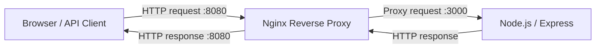
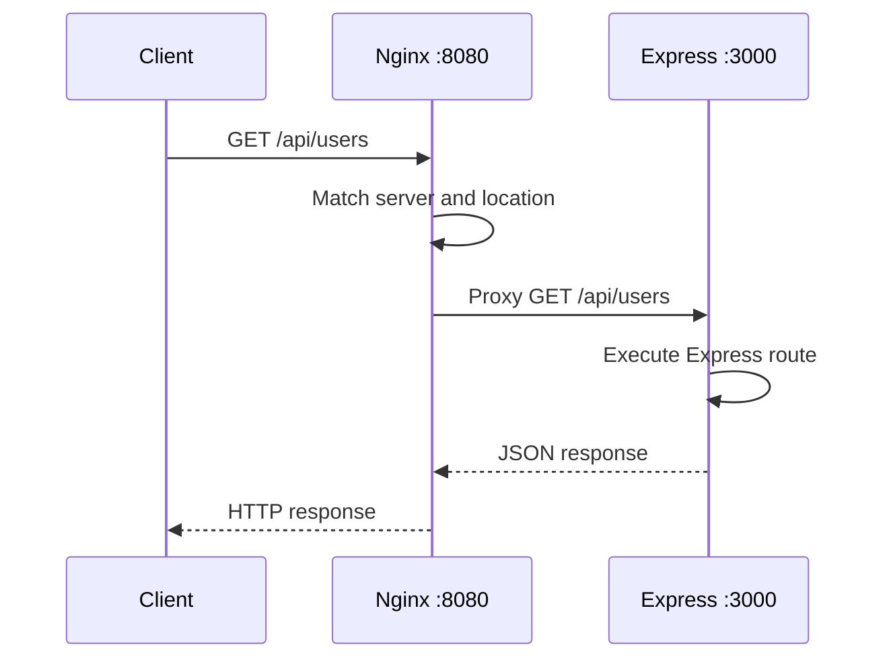

# Reverse Proxy with Nginx + Node.js/Express
## Theory, Ubuntu hands-on example, testing, troubleshooting, and interview questions

**Environment:** Ubuntu Linux, Nginx installed directly on the host, Node.js/Express running locally.  
**No Docker or Docker Compose required.**

---

## 1. What is a reverse proxy?

A **reverse proxy** is a server that receives requests from clients and forwards those requests to one or more backend servers.

The client communicates with the reverse proxy, not directly with the backend application.

For this practical example:

- Browser/client calls `http://localhost:8080`.
- Nginx receives the request on port `8080`.
- Nginx forwards it to Express running on port `3000`.
- Express sends its response to Nginx.
- Nginx returns the response to the client.

### Architecture



### Without a reverse proxy

```text
Client
  |
  | http://localhost:3000
  v
Node.js / Express
```

The client connects directly to the application port.

### With a reverse proxy

```text
Client
  |
  | http://localhost:8080
  v
Nginx :8080
  |
  | forwards request
  v
Express :3000
```

The client only needs to know the Nginx endpoint. The backend port can remain internal to the machine or private network.

---

## 2. Why do we use a reverse proxy?

Common reasons include:

1. **Hide backend details:** clients do not need to know internal application ports.
2. **Single entry point:** expose one public endpoint for one or more applications.
3. **TLS termination:** handle HTTPS certificates at Nginx and proxy to an internal HTTP service when appropriate.
4. **Load balancing:** distribute requests across multiple backend instances.
5. **Routing:** forward different paths or hostnames to different applications.
6. **Security controls:** apply request-size limits, IP rules, and rate limits.
7. **Compression and caching:** reduce response size or cache suitable responses.
8. **Logging:** centralize access and proxy error logs.

A reverse proxy does not automatically make an application secure or highly available. The proxy and backend still need appropriate configuration, monitoring, and redundancy.

---

## 3. Reverse proxy vs forward proxy vs load balancer vs API Gateway

| Component | Main purpose | Typical direction |
|---|---|---|
| Forward proxy | Represents clients when accessing external servers | Client → proxy → internet |
| Reverse proxy | Represents backend servers to incoming clients | Client → proxy → backend |
| Load balancer | Distributes traffic across multiple backend instances | Client → balancer → instance pool |
| API Gateway | Provides an API entry point with routing and API policies | Client → gateway → services |

These roles can overlap. Nginx can act as a reverse proxy, load balancer, and a lightweight API Gateway.

---

# 4. Hands-on project on Ubuntu

We will create a simple Express application and place Nginx in front of it.

## 4.1 Install/check prerequisites

Check whether Node.js and npm are installed:

```bash
node -v
npm -v
```

Check Nginx:

```bash
nginx -v
```

If Nginx is not installed:

```bash
sudo apt update
sudo apt install nginx -y
```

Start Nginx and enable it at boot:

```bash
sudo systemctl enable --now nginx
```

Check its status:

```bash
sudo systemctl status nginx
```

Open `http://localhost` in your browser. You should see the Nginx welcome page if the default site is enabled.

For this example, Node.js 20+ is recommended.

## 4.2 Create an Express project

```bash
mkdir -p ~/nginx-reverse-proxy
cd ~/nginx-reverse-proxy

npm init -y
npm install express
```

Create this structure:

```text
nginx-reverse-proxy/
├── package.json
└── server.js
```

## 4.3 Create `server.js`

```javascript
const express = require("express");
const os = require("node:os");

const app = express();

const PORT = Number(process.env.PORT || 3000);

app.use(express.json());

app.get("/", (req, res) => {
  res.json({
    message: "Hello from Express",
    service: "Node.js API",
    port: PORT,
    processId: process.pid,
    hostname: os.hostname(),
    time: new Date().toISOString()
  });
});

app.get("/api/users", (req, res) => {
  res.json({
    message: "Users returned from Express",
    users: [
      { id: 1, name: "Asha" },
      { id: 2, name: "Rahul" }
    ]
  });
});

app.get("/health", (req, res) => {
  res.status(200).json({
    status: "healthy"
  });
});

app.listen(PORT, "127.0.0.1", () => {
  console.log(`Express server listening on http://127.0.0.1:${PORT}`);
});
```

### Understand the important part

```javascript
app.listen(PORT, "127.0.0.1", () => {
  console.log(`Express server listening on ${PORT}`);
});
```

We bind Express to `127.0.0.1`, meaning it accepts connections from the local machine. Nginx on the same machine can connect to it, while external clients cannot directly connect to this loopback-bound service.

For a backend on a different machine or container, you would use the appropriate private interface/address and firewall rules instead.

## 4.4 Start Express

```bash
cd ~/nginx-reverse-proxy
node server.js
```

Keep this terminal running.

Open another terminal and test Express directly:

```bash
curl -i http://127.0.0.1:3000/
```

Test the users endpoint:

```bash
curl http://127.0.0.1:3000/api/users
```

Test health:

```bash
curl http://127.0.0.1:3000/health
```

At this stage, Express is working directly on port `3000`. Nginx has not been configured as a reverse proxy yet.

---

# 5. Configure Nginx as a reverse proxy

On Ubuntu, site configurations are commonly stored in:

```text
/etc/nginx/sites-available/
/etc/nginx/sites-enabled/
```

Create a new configuration:

```bash
sudo nano /etc/nginx/sites-available/node-reverse-proxy
```

Add:

```nginx
server {
    listen 8080;
    server_name localhost;

    location / {
        proxy_pass http://127.0.0.1:3000;

        proxy_http_version 1.1;

        proxy_set_header Host $host;
        proxy_set_header X-Real-IP $remote_addr;
        proxy_set_header X-Forwarded-For $proxy_add_x_forwarded_for;
        proxy_set_header X-Forwarded-Proto $scheme;

        proxy_connect_timeout 5s;
        proxy_send_timeout 30s;
        proxy_read_timeout 30s;
    }
}
```

Save the file:

- Press `Ctrl + O`.
- Press Enter.
- Press `Ctrl + X`.

## 5.1 Understand the Nginx configuration

| Directive | Explanation |
|---|---|
| `server` | Defines a virtual server configuration |
| `listen 8080` | Nginx accepts requests on port 8080 |
| `server_name localhost` | Matches the requested host |
| `location /` | Matches paths beginning with `/` |
| `proxy_pass` | Forwards the request to Express |
| `proxy_http_version` | Sets the HTTP version used to proxy upstream |
| `proxy_set_header Host` | Forwards the host header |
| `X-Real-IP` | Passes the client IP value to the backend |
| `X-Forwarded-For` | Carries the forwarded client IP chain |
| `X-Forwarded-Proto` | Passes the original request scheme |
| `proxy_connect_timeout` | Limits the time to establish an upstream connection |
| `proxy_read_timeout` | Limits the wait between successive upstream reads |

### Most important line

```nginx
proxy_pass http://127.0.0.1:3000;
```

This tells Nginx:

"When a matching request arrives, forward it to the Express application at `127.0.0.1:3000`."

---

# 6. Enable the Nginx site

Create a symbolic link:

```bash
sudo ln -s \
  /etc/nginx/sites-available/node-reverse-proxy \
  /etc/nginx/sites-enabled/node-reverse-proxy
```

If the link already exists, do not create it again.

Validate the configuration:

```bash
sudo nginx -t
```

Expected output includes:

```text
syntax is ok
test is successful
```

Reload Nginx:

```bash
sudo systemctl reload nginx
```

If port `8080` is already in use, inspect it:

```bash
sudo ss -lntp | grep :8080
```

---

# 7. Test the reverse proxy

Now call Nginx rather than calling Express directly:

```bash
curl -i http://localhost:8080/
```

Test the users endpoint:

```bash
curl -i http://localhost:8080/api/users
```

Test health:

```bash
curl -i http://localhost:8080/health
```

The response should come from Express, even though the client called port `8080`.

### Compare direct and proxied requests

Direct Express request:

```bash
curl http://127.0.0.1:3000/
```

Request through Nginx:

```bash
curl http://localhost:8080/
```

Both reach the same Express application, but the second request travels through Nginx first.

---

# 8. Understand the request flow



Step by step:

1. The client sends a request to `localhost:8080`.
2. Nginx accepts the connection.
3. Nginx selects the matching `server` and `location`.
4. `proxy_pass` forwards the request to Express.
5. Express executes the matching route.
6. Express returns a response to Nginx.
7. Nginx returns the response to the client.

---

# 9. Important experiment: change the backend port

Stop Express with `Ctrl+C`.

Start it on port `3001`:

```bash
PORT=3001 node server.js
```

Now Nginx still points to port `3000`, so the proxy request will fail.

You should see a gateway error, typically HTTP `502 Bad Gateway`.

Update Nginx:

```nginx
proxy_pass http://127.0.0.1:3001;
```

Validate and reload:

```bash
sudo nginx -t
sudo systemctl reload nginx
```

Try again:

```bash
curl -i http://localhost:8080/
```

This experiment demonstrates that Nginx must be configured with the correct backend address and port.

---

# 10. Add path-based reverse proxy routing

A reverse proxy can route different paths to different applications.

For this experiment, run two Express applications:

- User Service on port `3001`.
- Order Service on port `3002`.

You can create separate Express files or use the same application with different environment variables.

Example Nginx configuration:

```nginx
server {
    listen 8080;
    server_name localhost;

    location /api/users/ {
        proxy_pass http://127.0.0.1:3001/;
        proxy_set_header Host $host;
        proxy_set_header X-Real-IP $remote_addr;
        proxy_set_header X-Forwarded-For $proxy_add_x_forwarded_for;
        proxy_set_header X-Forwarded-Proto $scheme;
    }

    location /api/orders/ {
        proxy_pass http://127.0.0.1:3002/;
        proxy_set_header Host $host;
        proxy_set_header X-Real-IP $remote_addr;
        proxy_set_header X-Forwarded-For $proxy_add_x_forwarded_for;
        proxy_set_header X-Forwarded-Proto $scheme;
    }
}
```

With a trailing slash in `proxy_pass`, Nginx replaces the matching location prefix with `/` when forwarding.

Example:

| Client request | Backend receives |
|---|---|
| `/api/users/users` | `/users` on port 3001 |
| `/api/orders/orders` | `/orders` on port 3002 |

**Important:** URI rewriting depends on the exact `location` and `proxy_pass` syntax. A `proxy_pass` URL with a URI component behaves differently from one without a URI component. Test the actual upstream path rather than guessing.

---

# 11. Add basic rate limiting

Nginx can limit request rates using `limit_req`.

Inside the `http` context in `/etc/nginx/nginx.conf`, add:

```nginx
limit_req_zone $binary_remote_addr zone=api_limit:10m rate=5r/s;
```

Inside a `location` block, add:

```nginx
limit_req zone=api_limit burst=10 nodelay;
```

This configures an average rate of five requests per second per client key, with a burst allowance.

Test:

```bash
for i in {1..30}; do
  curl -s -o /dev/null -w "%{http_code}\n" \
    http://localhost:8080/api/users
done
```

Nginx normally returns HTTP `503` for rejected requests unless `limit_req_status` is changed.

If another proxy sits in front of Nginx, configure trusted real-IP handling correctly; otherwise, all requests may appear to come from that proxy's IP.

---

# 12. Troubleshooting

## Problem 1: 502 Bad Gateway

Possible causes:
- Express is not running.
- Nginx is forwarding to the wrong port.
- Backend address is incorrect.
- Nginx cannot connect to the backend.
- The application closes the connection unexpectedly.

Check Express:

```bash
curl -i http://127.0.0.1:3000/
```

Check listening ports:

```bash
sudo ss -lntp
```

Check Nginx error log:

```bash
sudo tail -f /var/log/nginx/error.log
```

## Problem 2: 404 Not Found

Possible causes:
- Express does not have the requested route.
- Nginx selected a different `location`.
- URI rewriting or `proxy_pass` path behavior is incorrect.

Inspect the effective Nginx configuration:

```bash
sudo nginx -T
```

## Problem 3: Nginx configuration test fails

Run:

```bash
sudo nginx -t
```

Check:
- Missing semicolons.
- Missing or extra braces.
- Incorrect directive placement.
- Duplicate or conflicting listen configuration.

## Problem 4: Port already in use

```bash
sudo ss -lntp | grep :8080
```

Find which process owns the port and either stop it or choose a different Nginx listening port.

---

# 13. Useful Ubuntu commands

| Purpose | Command |
|---|---|
| Check Nginx version | `nginx -v` |
| Check Nginx status | `sudo systemctl status nginx` |
| Start Nginx | `sudo systemctl start nginx` |
| Stop Nginx | `sudo systemctl stop nginx` |
| Restart Nginx | `sudo systemctl restart nginx` |
| Reload config | `sudo systemctl reload nginx` |
| Validate config | `sudo nginx -t` |
| View full config | `sudo nginx -T` |
| View access log | `sudo tail -f /var/log/nginx/access.log` |
| View error log | `sudo tail -f /var/log/nginx/error.log` |
| Inspect listening ports | `sudo ss -lntp` |

---

# 14. Reverse proxy interview questions and answers

## Fundamentals

### 1. What is a reverse proxy?

A reverse proxy receives client requests and forwards them to backend servers. Clients communicate with the proxy rather than directly with the backend.

### 2. Why do we use Nginx in front of Node.js?

Nginx provides a stable entry point, request routing, TLS termination, load balancing, request limits, and centralized logging. It can also serve static content efficiently.

### 3. What is the difference between a forward proxy and a reverse proxy?

A forward proxy represents clients accessing external servers. A reverse proxy represents backend servers receiving inbound client requests.

### 4. Is every reverse proxy a load balancer?

No. A reverse proxy can forward all traffic to one backend. It becomes a load balancer when it distributes traffic across multiple backend targets.

### 5. Can Nginx proxy requests to multiple Node.js applications?

Yes. It can use different `location` blocks or server blocks to route requests to different backend services.

## Nginx

### 6. What does `proxy_pass` do?

It forwards a request to a specified backend address or upstream group.

### 7. What is the purpose of `proxy_set_header`?

It sets or forwards request headers to the backend. Common examples include `Host`, `X-Real-IP`, `X-Forwarded-For`, and `X-Forwarded-Proto`.

### 8. What is `X-Forwarded-For`?

It is a header commonly used to carry the originating client IP through one or more proxies. Applications should trust it only when it comes through known proxies.

### 9. What is `X-Real-IP`?

It is a commonly used header that carries the client IP value to the backend. The proxy should overwrite it with a trusted value.

### 10. What is the difference between `proxy_connect_timeout` and `proxy_read_timeout`?

The connection timeout limits how long Nginx waits to establish the upstream connection. The read timeout limits the wait between successive reads from the upstream.

### 11. What happens if the Node.js backend goes down?

Nginx cannot connect to the backend and typically returns `502 Bad Gateway`. The error log helps identify the connection failure.

### 12. What is the difference between 502 and 504?

502 generally indicates a failed connection or invalid upstream response. 504 indicates that the upstream did not respond within the configured timeout.

### 13. What is the difference between `reload` and `restart`?

A reload applies configuration changes gracefully and attempts to keep existing workers and connections operating during the transition. A restart stops and starts the service, which can interrupt active connections.

## Node.js and Express

### 14. Why bind Express to `127.0.0.1`?

When Nginx and Express run on the same machine, binding to loopback lets the local proxy connect while preventing direct access through external network interfaces.

### 15. How can Express identify the original client IP?

Nginx can forward `X-Forwarded-For`. Express can use forwarded headers when `trust proxy` is configured correctly. Trust only the actual proxy chain.

### 16. What is Express `trust proxy`?

It tells Express which proxy hops or addresses are trusted when interpreting forwarded headers and request properties such as `req.ip` and `req.protocol`.

Example for a known one-proxy setup:

```javascript
app.set("trust proxy", 1);
```

Do not blindly trust arbitrary client-supplied forwarding headers.

### 17. Why use multiple Node.js processes?

Multiple processes can use multiple CPU cores and provide additional capacity. Nginx can distribute incoming requests among those processes.

### 18. Does a reverse proxy make Node.js faster?

Not automatically. It can improve traffic management, TLS handling, and connection management, but the application's database, CPU, and downstream dependencies can still be bottlenecks.

## Scenario-based questions

### 19. Express works on port 3000 but Nginx returns 502. What do you check?

Check that Express is running, the Nginx upstream address and port are correct, the backend is reachable from the Nginx host, and the Nginx error log does not show connection failures.

### 20. Why does Nginx return 404 when the Express route works directly?

The Nginx location may not match, or the URI passed to Express may be different because of `proxy_pass` trailing-slash behavior or rewrite rules.

### 21. How would you expose two Express applications through one Nginx port?

Create separate `location` blocks, such as `/api/users/` and `/api/orders/`, and forward each to its corresponding backend.

### 22. How would you enable HTTPS?

Configure an SSL-enabled Nginx server block with a certificate and private key, listen on port 443, and proxy requests to the backend. Use a trusted certificate and automate renewal.

### 23. How would you avoid exposing the Express port publicly?

Bind Express to loopback when Nginx is on the same machine, or bind it to a private interface and restrict access using firewall/network rules.

### 24. How would you debug slow responses?

Compare direct backend latency with proxied latency. Inspect Nginx access/error logs, upstream response times, application logs, database latency, and resource utilization.

### 25. Can Nginx route based on domain names instead of URL paths?

Yes. Configure multiple `server` blocks with different `server_name` values and route each host to a different backend.

---

# 15. Practical assignments

Complete these exercises:

1. Run Express on port `3000` and Nginx on port `8080`.
2. Confirm that direct Express access and proxied access both work.
3. Change the Express port and observe the 502 error.
4. Update `proxy_pass` and restore the service.
5. Add a second Express application on port `3001`.
6. Route `/api/users/` and `/api/orders/` to different applications.
7. Experiment with `proxy_pass` trailing slash behavior.
8. Add request-size limits.
9. Add rate limiting.
10. Configure HTTPS on a local or test environment.
11. Inspect access and error logs.
12. Put two Express instances behind an Nginx upstream group and compare this with a single-backend reverse proxy.

For each assignment, document:

**Hypothesis → Change → Test → Observation → Conclusion**

---

# 16. Two-minute interview explanation

"A reverse proxy sits between clients and backend applications. In our Node.js architecture, clients call Nginx on a public port instead of connecting directly to Express. Nginx receives the request, matches a server and location block, and forwards it to the configured backend using `proxy_pass`.

We forward useful metadata such as the original host, client IP chain, and request protocol through proxy headers. We configure connection and read timeouts, request-size limits, and logging. Nginx can also route different paths to different Express applications and distribute traffic across multiple instances using upstream groups.

This gives us a stable entry point and hides internal backend details. We still need to configure trusted proxy handling in Express, secure the backend network, monitor failures, and make the application resilient."

---

# 17. Official documentation

- Nginx proxy module: https://nginx.org/en/docs/http/ngx_http_proxy_module.html
- Nginx core module: https://nginx.org/en/docs/ngx_core_module.html
- Nginx beginner's guide: https://nginx.org/en/docs/beginners_guide.html
- Express behind proxies: https://expressjs.com/en/guide/behind-proxies.html
- Express production best practices: https://expressjs.com/en/advanced/best-practice-performance.html
- Node.js HTTP: https://nodejs.org/api/http.html

---

## Final revision checklist

- [ ] Explain reverse proxy in your own words.
- [ ] Draw the client → Nginx → Express request flow.
- [ ] Explain `proxy_pass`.
- [ ] Explain forwarded headers.
- [ ] Explain `proxy_connect_timeout` and `proxy_read_timeout`.
- [ ] Test a 502 Bad Gateway scenario.
- [ ] Explain `proxy_pass` URI/trailing-slash behavior.
- [ ] Configure path-based routing.
- [ ] Explain reverse proxy vs load balancer vs API Gateway.
- [ ] Explain how Express should trust proxy headers.

**Learning tip:** First make the simple one-backend reverse proxy work. Then add a second backend and path-based routing. Finally, compare reverse proxying with load balancing and API Gateway behavior.
